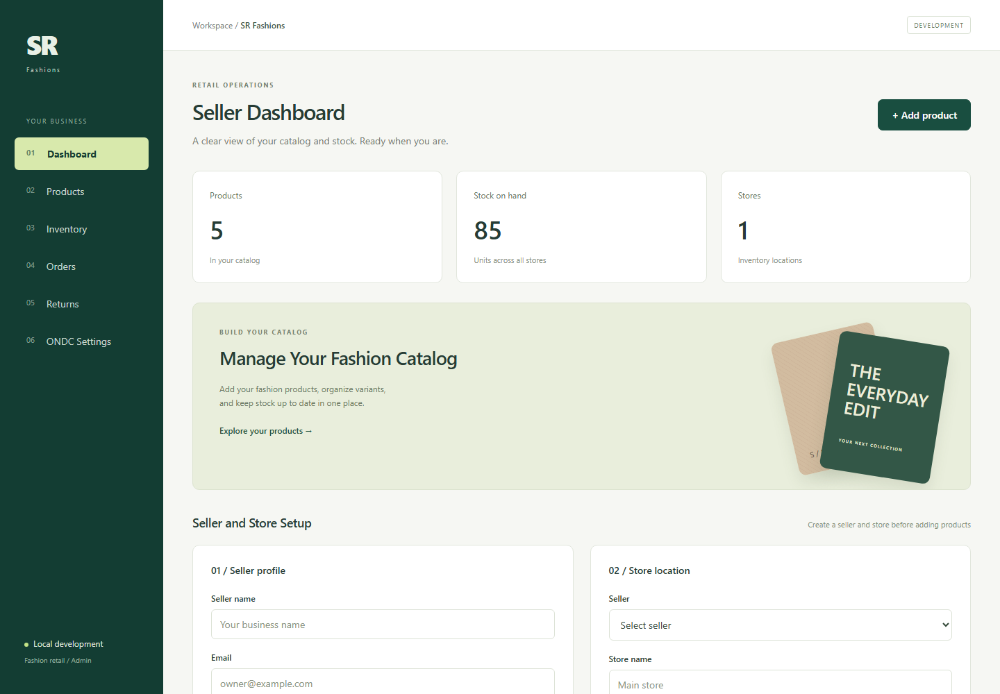
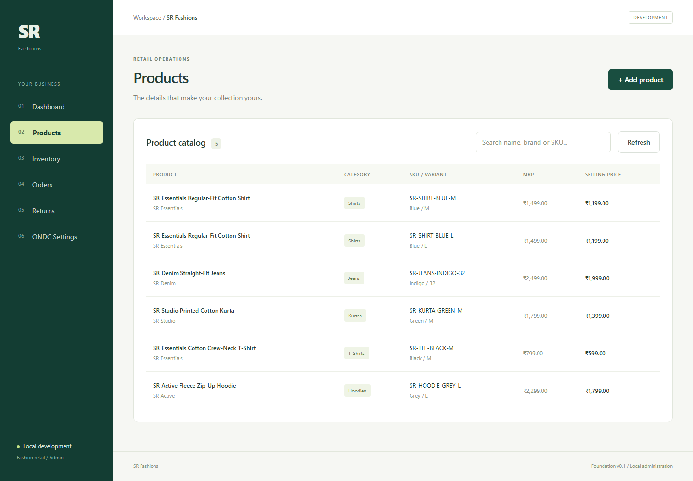
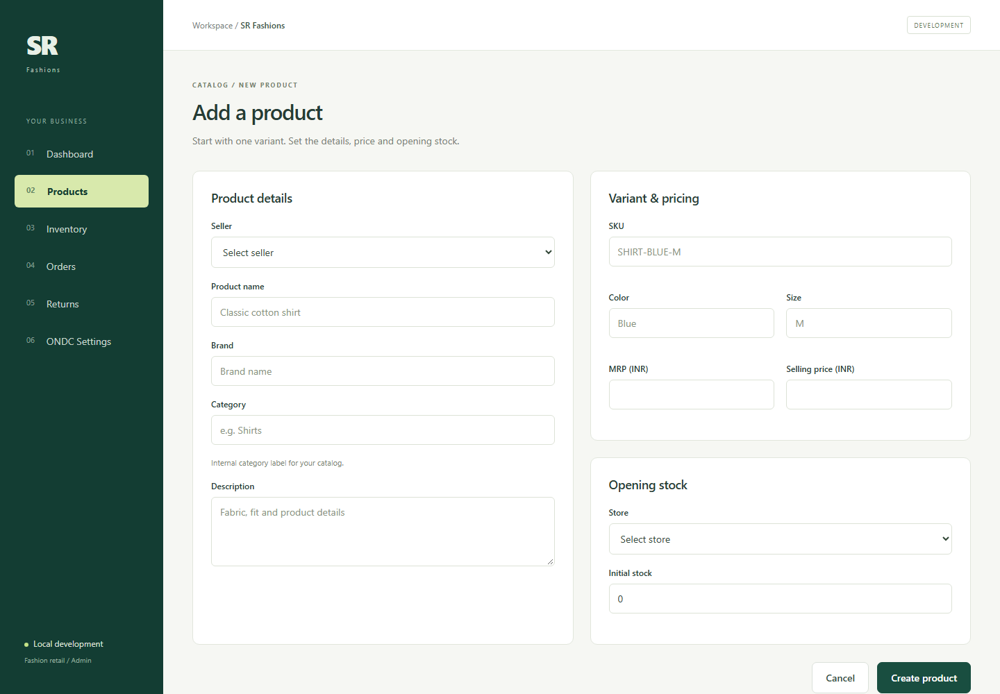
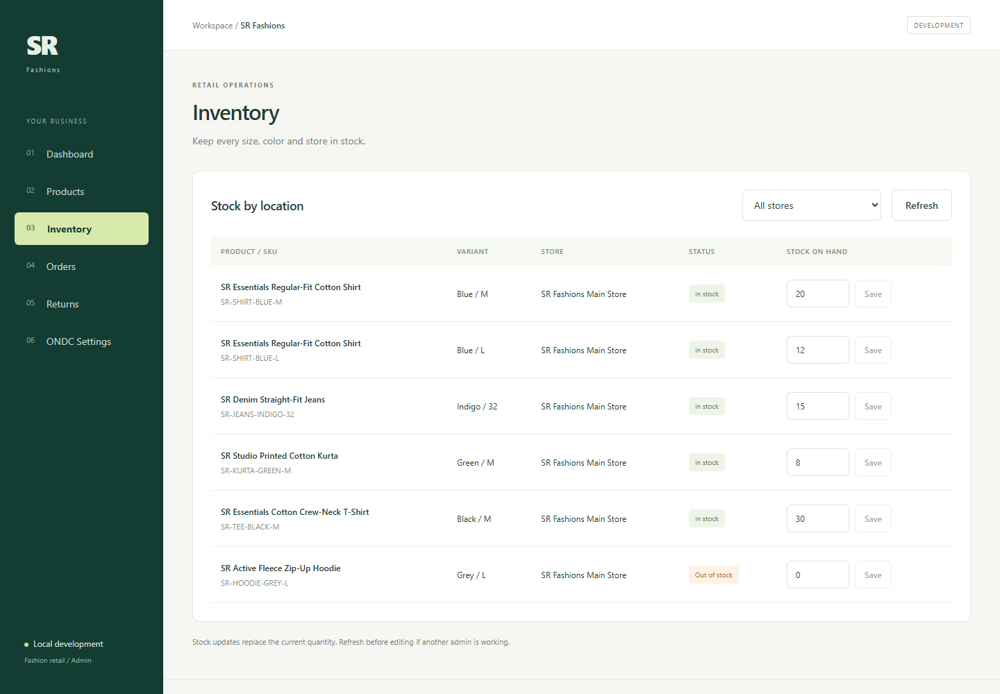
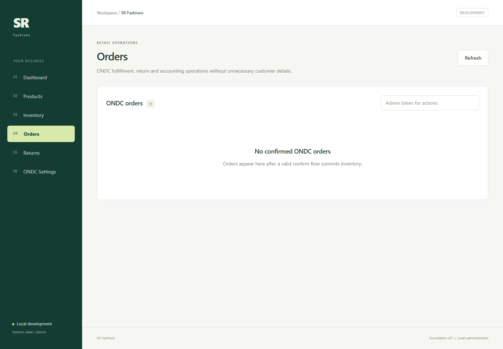
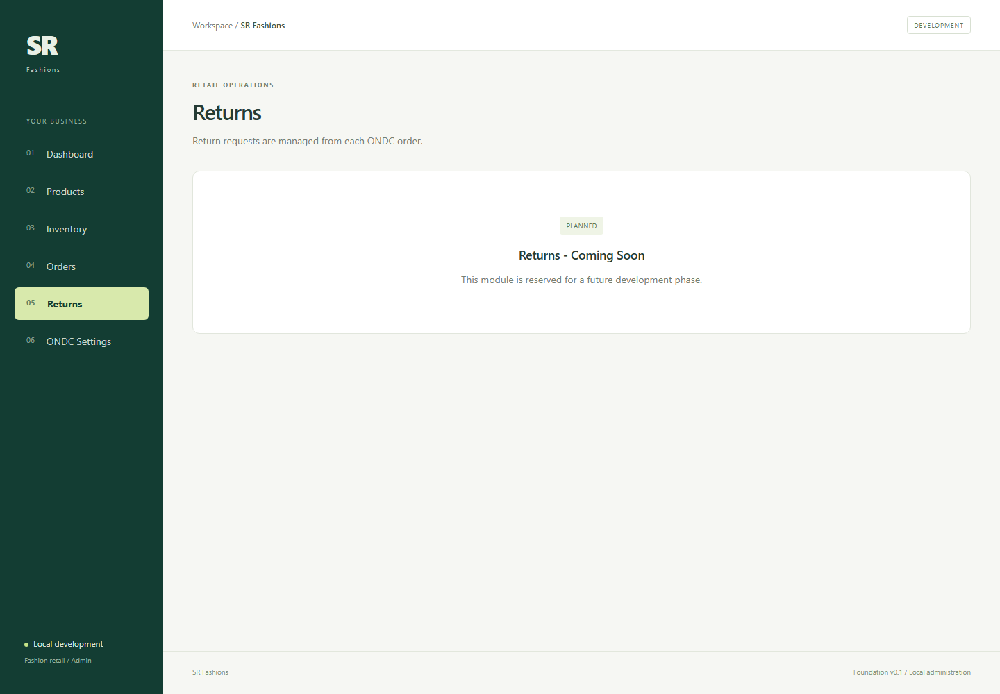
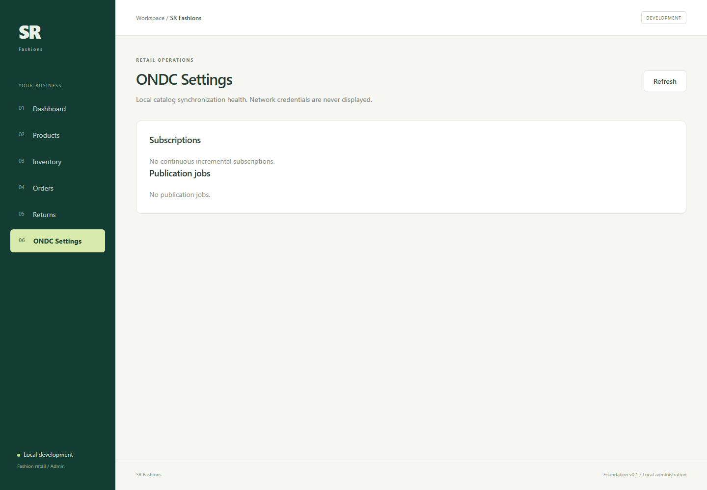

# SR Fashions - local foundation

FastAPI/PostgreSQL inventory backend and React retailer administration workspace.
Target future domain: **ONDC:RET12**. This is an internal retail application, not
an ONDC-compliant protocol implementation or a customer storefront.

A fresh clone needs one-time prerequisite and dependency installation before start.bat works.
See [SETUP.md](SETUP.md) for the steps, or copy the detailed
[Copilot local setup prompt](docs/COPILOT_LOCAL_SETUP_PROMPT.md) into Copilot Chat in Agent mode.

## Practical walkthrough and screenshots

These screenshots were captured from the running application after loading the reusable
sample catalog. The example has five products, six SKUs, one store and 85 units on hand.
The hoodie intentionally has zero stock so the out-of-stock behavior is visible.

To reproduce the same catalog on a running local installation:

```powershell
.\backend\.venv312\Scripts\python.exe .\scripts\seed_catalog.py
```

The seed is idempotent: it preserves existing records and skips sample SKUs that already
exist. A fresh database remains empty until an operator creates data or runs this command.

### 1. Dashboard and seller/store setup

Open `http://127.0.0.1:5173/`. The summary cards show product count, total stock and
store count. For a new installation, first create a seller profile with a unique email,
then create a store linked to that seller. These records become the ownership and stock
location used when products are created.



### 2. Browse and search the product catalog

Choose **Products** to see each SKU with product name, brand, internal category, size,
color, MRP and selling price. Use the search box for a product, brand or SKU. In this
sample, the shirt has separate M and L variants while the other products have one SKU.



### 3. Add a product with opening stock

Choose **Add product** from the dashboard or visit `/products/new`. Select the seller,
enter the product and variant attributes, select the stock location, and supply the
initial quantity. **Create product** commits the product, variant and opening inventory
in one database transaction, so a partial catalog entry is not left behind on failure.



### 4. Maintain store-level inventory

Choose **Inventory** to filter by store and edit the quantity for an individual SKU.
Enter the new absolute quantity and select **Save**. Refresh before editing when another
operator may also be working. The screenshot demonstrates both in-stock badges and the
zero-stock hoodie. ONDC order confirmation and supported cancellation use transactional
stock commitment/restoration rather than this manual form.



### 5. Review and operate ONDC orders

Choose **Orders** after a valid signed Buyer App `confirm` flow. Each confirmed order can
be expanded to inspect items, fulfillment state, append-only history, financial events
and supported return requests without displaying unnecessary customer details. Enter the
backend admin token only when performing authorized fulfillment or return decisions; it
is held in browser memory and is not bundled into the frontend.

The screenshot shows the honest empty state because the sample catalog command does not
fabricate a signed Buyer App transaction. Orders appear only through the authenticated
ONDC purchase flow.



### 6. Returns workflow boundary

The separate **Returns** route currently explains that it is planned. Supported RET12
return initiation and authenticated approve/reject decisions are implemented inside the
relevant confirmed order on the Orders page. Reverse pickup, QC, liquidation, replacement
and actual refund execution remain explicitly unsupported until their governing profiles
are verified and implemented.



### 7. Monitor ONDC catalog synchronization

Choose **ONDC Settings** to inspect durable incremental subscriptions and publication
jobs. Active or failed work appears here after a valid catalog incremental request and
the scheduler persists it. The sample screen is empty because no external Buyer App or
Registry was contacted while preparing this public repository.



### 8. API, health and operational checks

- Swagger UI: `http://127.0.0.1:8000/docs`
- Database-backed health: `http://127.0.0.1:8000/health`
- Process liveness: `http://127.0.0.1:8000/livez`
- Deployment readiness: `http://127.0.0.1:8000/readyz`
- Live CRUD smoke: `.\backend\.venv312\Scripts\python.exe .\scripts\smoke.py`

The authenticated internal metrics endpoint reports HTTP outcomes, callback/Registry
counters and queue backlog. It is intended for protected operational access, not public
exposure.

## Architecture

```text
sr-fashions-seller-platform/
├── backend/
│   ├── alembic/                 # Database migrations 0001–0005
│   ├── app/
│   │   ├── api/                 # Internal seller, store, product and stock REST API
│   │   ├── models/              # Core catalog ORM models
│   │   ├── services/            # Transactional catalog business logic
│   │   └── ondc/
│   │       ├── catalog/         # Mapping, publication, lifecycle and sync scheduler
│   │       ├── clients/         # Signed outbound HTTP transport
│   │       ├── onboarding/      # Keys, challenge handling, preview and readiness CLI
│   │       ├── protocol/        # Replay, purchase and post-order domain services
│   │       ├── registry/        # Signed Registry v2 lookup
│   │       ├── routes/          # Search, purchase, post-order and onboarding endpoints
│   │       ├── schemas/         # Strict RET12 request/response models
│   │       ├── signing/         # Ed25519/BLAKE2b signing and verification
│   │       └── validators/      # Protocol and catalog validation
│   ├── tests/                   # Unit, integration, concurrency and mock-Buyer tests
│   └── Dockerfile               # Production API/worker image
├── frontend/
│   ├── src/pages/               # Dashboard, catalog, inventory, orders and ONDC status
│   ├── Dockerfile               # Production React build and Nginx image
│   └── nginx.conf               # SPA serving and security headers
├── deploy/Caddyfile             # HTTPS reverse-proxy routing and response headers
├── docs/                        # Design, validation, security and completion reports
├── postman/                     # Local internal-API Postman collection
├── scripts/                     # Environment initialization, seeding and smoke tests
├── docker-compose.yml           # Loopback-only local PostgreSQL
├── docker-compose.production.yml # Provider-neutral production-like stack
├── SETUP.md                     # Installation, startup and troubleshooting
└── start.bat                    # One-click Windows development launcher
```

### Main files added during the ONDC expansion

| Area | Files | Purpose |
| --- | --- | --- |
| Orders | `protocol/purchase.py`, `routes/purchase.py`, `schemas/orders.py` | Signed select/init/confirm, quote persistence and atomic stock commitment |
| Post-order | `protocol/post_order.py`, `routes/post_order.py`, `schemas/post_order.py` | Status, supported cancellation/return flows and idempotent state history |
| Catalog sync | `catalog/lifecycle.py`, `catalog/scheduler.py` | Publication state, durable subscriptions, leasing, retry and recovery |
| Database | migrations `0004` and `0005`, `ondc/models.py` | Checkout, order, audit, return, subscription and job persistence |
| Onboarding | `onboarding/crypto.py`, `service.py`, `cli.py`, `routes/onboarding.py` | X25519/Ed25519 keys, site verification, challenge response and safe preview |
| Operations | `operations.py`, `admin_security.py` | Correlation IDs, limits, metrics and administrative authorization |
| Admin UI | `Orders.jsx`, `OndcSettings.jsx` | Order lifecycle/audit display and catalog synchronization visibility |
| Deployment | backend/frontend Dockerfiles, `deploy/Caddyfile`, production Compose | HTTPS edge, API, frontend, worker and private persistent PostgreSQL |
| Documentation | `ONDC_*` and `PROMPT_*_COMPLETION_REPORT.md` | Supported scope, evidence, security operations, deployment and remaining blockers |

The generated build output, virtual environments, local `.env` files, private keys,
database dumps and PostgreSQL data are deliberately excluded from Git.

## Internal REST API

Open `http://127.0.0.1:8000/docs` for complete request and response schemas.

| Resource | Operations |
| --- | --- |
| `/`, `/health` | GET; health checks database connectivity |
| `/api/sellers` | GET list, POST |
| `/api/sellers/{id}` | GET, PUT, DELETE |
| `/api/stores` | GET list, POST |
| `/api/stores/{id}` | GET, PUT, DELETE |
| `/api/products` | GET list, POST with variants and optional initial stock |
| `/api/products/{id}` | GET, PUT product details, DELETE |
| `/api/products/{id}/variants/{variant_id}` | PUT variant details and prices |
| `/api/inventory` | GET list, POST |
| `/api/inventory/{id}` | GET, PUT quantity, DELETE |

Lists accept `offset` and `limit` (default 100, maximum 200); products/stores can
filter by `seller_id`, inventory by `store_id`. Frontend traverses all pages.
PUT replaces the fields described by the corresponding request schema. Seller
ownership of products and stores is immutable. SKU is globally unique for this
foundation. Prices use fixed-precision decimals; JSON responses serialize them
as strings. Admin prices are displayed in INR as a local application choice.

Product creation, variants, and opening stock are atomic. Inventory has one row
per store/variant, nonnegative integer quantity, and same-seller ownership checks.
Deleting products also deletes their variants/inventory. Sellers and stores with
dependent records cannot be deleted (409). Validation returns 422, absent resources
404, uniqueness/dependency conflicts 409, database unavailability 503.

## Scope and operational limits

Dashboard includes seller/store setup, catalog counts and stock totals. Products
supports search. Add Product creates one initial variant (API supports multiple).
Inventory supports store filtering and quantity editing. Orders now shows the
persisted ONDC order, fulfillment, state, financial and return audit trails. ONDC
Settings shows durable catalog-subscription and publication-job status.

### Current ONDC progress

- Retail B2C 1.2.5 / `ONDC:RET12` Seller ISN discovery and signed callbacks.
- Authenticated `select`, `init`, `confirm`, `status`, supported `cancel` and constrained
  return `update` flows with replay protection, durable retries and PostgreSQL locking.
- Atomic inventory commitment/restoration, order history, financial-event audit and
  authenticated fulfillment/return administration.
- Full and incremental catalog publication, persistent synchronization jobs and recovery.
- Ed25519 signing, Registry v2 lookup, X25519 onboarding keys, site verification,
  `/on_subscribe`, redacted subscription preview and a read-only readiness CLI.
- Production-like Compose scaffolding with HTTPS proxy, isolated PostgreSQL, background
  worker, health/readiness endpoints, structured logs and operational metrics.
- Current local verification: 167 backend tests pass with PostgreSQL concurrency enabled,
  Alembic is at migration 0005 with no drift, React production build and live smoke pass.

See [Prompt 5 completion](docs/PROMPT_5_COMPLETION_REPORT.md),
[PreProd readiness](docs/ONDC_PREPROD_READINESS.md) and
[deployment](docs/ONDC_DEPLOYMENT.md) for evidence and operating instructions.

### Pending and externally blocked

- Real organization, subscriber, domain, city and merchant-policy details.
- Public HTTPS/OCSP, approved secret-manager keys, ONDC Portal access and PreProd
  subscriber-ID whitelisting.
- Explicitly authorized Registry subscription, signed lookup confirmation, Workbench/log
  validation and external interoperability evidence.
- Reverse pickup/QC/liquidation, actual refund and settlement confirmation,
  exchange/replacement, broader payment/logistics profiles and verified seller-force
  cancellation governance.
- Named-user MFA/RBAC, distributed edge rate limiting, centralized monitoring, tested
  backup/restore and a reviewed multi-instance hosting deployment.

External network communication remains disabled by default. No Registry subscription,
public deployment, DNS change or certification claim has been made. Category, color and
size remain free-text internal fields with explicit publication mapping.

Local development uses loopback access. PreProd/production configuration fails closed
without strong administrative authentication and explicit HTTPS CORS origins. Inventory
uses absolute quantity replacement for internal administration; ONDC order commitment is
handled separately with transactional locking.
Timestamps are UTC-aware on PostgreSQL; updates are maintained by SQLAlchemy.
No automatic schema creation runs at application startup; use Alembic.

`.env` files and virtual environments are ignored. Only the public API URL belongs
in `frontend/.env`; all `VITE_` values are public browser configuration. Random local
database credentials are generated outside source code. The source repository is [tnsurendra/sr-fashions-seller-platform](https://github.com/tnsurendra/sr-fashions-seller-platform).
Production-like deployment files are included but no cloud provider or public host is configured.

Implementation references: [FastAPI testing](https://fastapi.tiangolo.com/tutorial/testing/),
[SQLAlchemy relationships](https://docs.sqlalchemy.org/en/20/orm/basic_relationships.html),
[Vite setup](https://vite.dev/guide/).
