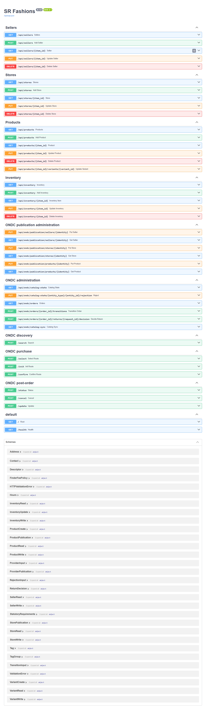
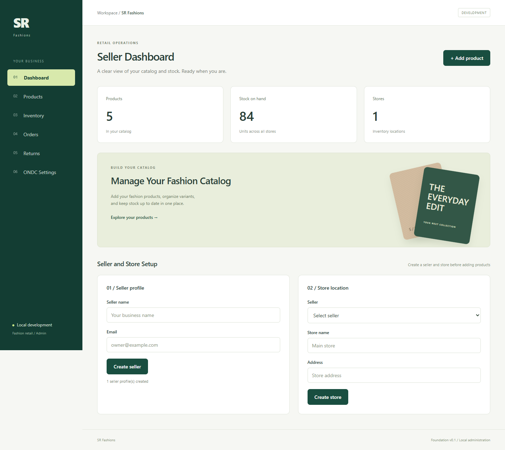
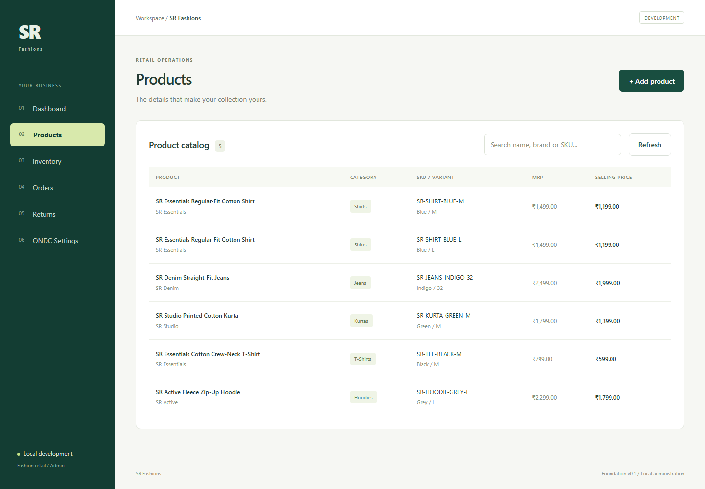
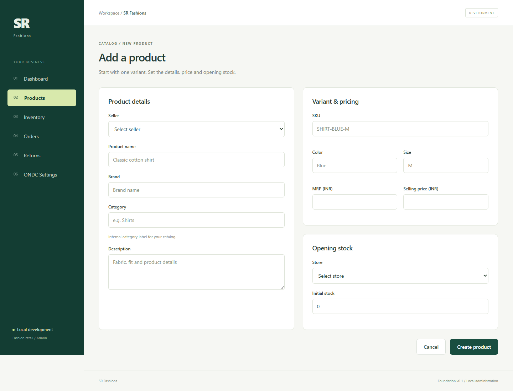
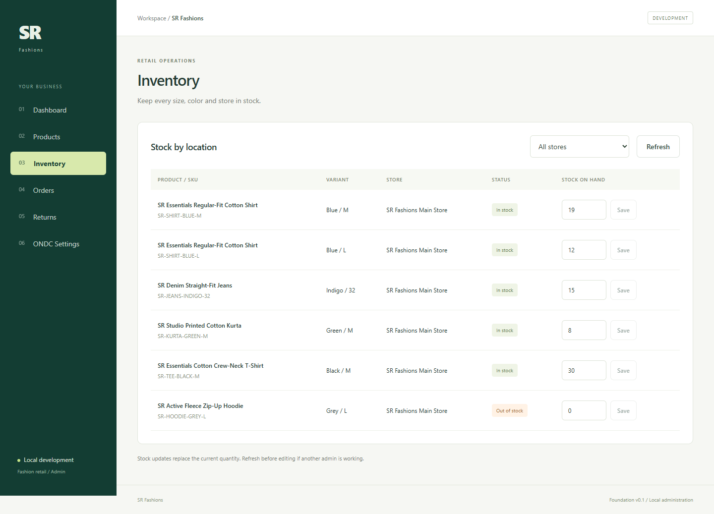
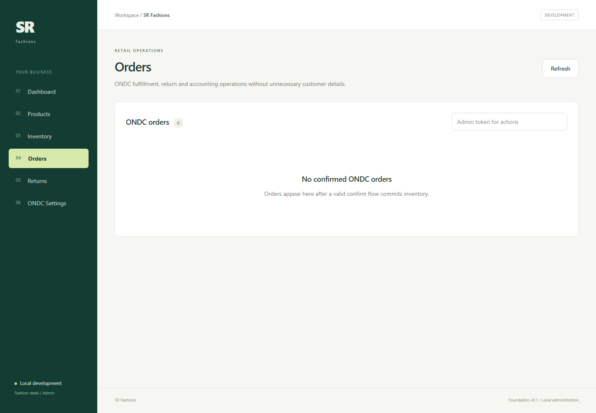
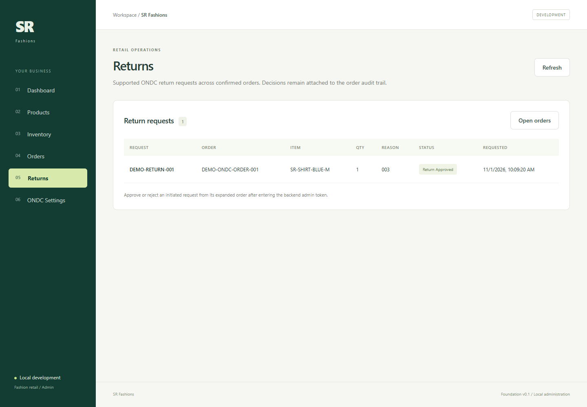
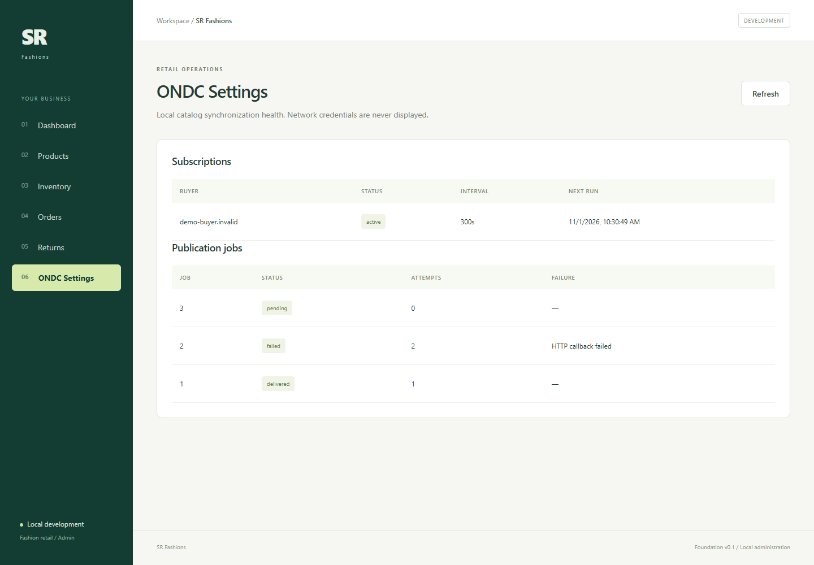

# End-to-end functionality demonstration

This guide demonstrates the complete implemented local flow as an engineering handoff.
It distinguishes real application behavior from synthetic documentation data and from
external ONDC evidence that still requires authorization.

## 1. Start and verify the stack

```powershell
.\start.bat --no-pause
Invoke-RestMethod http://127.0.0.1:8000/health
Invoke-RestMethod http://127.0.0.1:8000/readyz
```

Expected results are database-backed `ok` and `ready`. The UI is served at
`http://127.0.0.1:5173` and Swagger at `http://127.0.0.1:8000/docs`.



## 2. Seed reproducible demonstration data

```powershell
.\backend\.venv312\Scripts\python.exe .\scripts\seed_catalog.py
.\backend\.venv312\Scripts\python.exe .\scripts\seed_demo_order.py
```

Both commands are idempotent. The catalog seed uses the normal running REST API and
creates five products, six variants, one store and mixed inventory. The order seed uses
the persisted application models to create one explicitly synthetic read-model example.
It commits one unit of `SR-SHIRT-BLUE-M` exactly once.

The demo order does **not** claim to be a signed Buyer App request, Registry interaction,
payment settlement, refund, certification result or PreProd transaction. Its IDs begin
with `DEMO-`, its Buyer identifier uses the reserved `.invalid` domain, and it contains
no real customer data.

## 3. Seller catalog workflow

1. Create the seller and store from Dashboard, or use the catalog seed.
2. Create a product with one SKU, prices and opening stock.
3. Confirm the product and variant appear in Products.
4. Adjust the absolute stock quantity in Inventory.
5. Search by product, brand or SKU.









Database guarantees demonstrated by the automated suite include unique seller email and
SKU, seller/store ownership, one inventory row per store/variant, Decimal price rules,
nonnegative quantity and atomic product/variant/opening-stock creation.

## 4. ONDC discovery and purchase sequence

The authenticated protocol path is asynchronous after each inbound request:

```text
Buyer/Gateway     Seller API              PostgreSQL             Buyer callback
     | POST /search    |                       |                         |
     | signed payload  | verify + replay claim |                         |
     |<---- ACK -------| persist callback job  |                         |
     |                 |---------------------->|                         |
     |                 | signed gzip on_search |------------------------>|
     |                 |<------------------------------ callback ACK ----|
     |
     | POST /select -> ACK -> signed on_select
     | POST /init   -> ACK -> signed on_init
     | POST /confirm-> ACK -> row-lock stock -> order -> signed on_confirm
```

The mock Buyer tests sign every inbound request, verify every Seller signature, validate
correlation IDs and schemas, and exercise replay, callback failure/retry, stock races and
idempotency. Run the complete evidence suite with:

```powershell
cd backend
$env:ONDC_TEST_POSTGRES='1'
.\.venv312\Scripts\python.exe -m pytest -q --basetemp=.pytest-e2e
```

## 5. Order fulfillment, accounting and returns

Open Orders and expand `DEMO-ONDC-ORDER-001`. The view demonstrates:

- confirmed item, quantity and INR totals;
- accepted, packed, ready-for-pickup, picked-up and delivered history;
- expected-payment and Buyer-reported-paid events without claiming settlement;
- approved reason `003` return request;
- admin-token-gated transition controls;
- omission of unnecessary billing/contact details.



For real protocol traffic, `status` returns the persisted current state. Supported Buyer
cancellation uses verified reason `006`, enforces the persisted fulfillment TAT and
pre-pickup eligibility, restores stock once under a database lock, and records a refund
obligation rather than claiming a completed refund. Supported delivered-item return
initiation validates reason `003`, purchased quantity, catalog eligibility and window.

The Returns page aggregates persisted requests across orders. An operator can open the
related order for the complete history and authenticated decisions; this keeps the
decision in its order context while still providing an operational queue.



## 6. Catalog synchronization and recovery

Incremental `catalog_inc` start/stop requests create durable subscriptions. The scheduler
creates unique time-window jobs, workers claim leases with PostgreSQL locking, callbacks
are signed and compressed, and failures use bounded retry/backoff. Restart recovery is
covered by automated tests.



The seeded `.invalid` buyer demonstrates an active subscription and delivered, failed and
pending job states without contacting an external participant. Failure text is sanitized
and the attempts column makes retry behavior observable.

## 7. Registry onboarding readiness

The local implementation provides:

- raw Ed25519 signature of the stable onboarding request ID;
- X25519 keys with public SubjectPublicKeyInfo DER/base64 encoding;
- `/ondc-site-verification.html`;
- prefix-aware `/on_subscribe` challenge handling;
- a redacted Seller App `ops_no: 2` preview;
- a read-only readiness CLI.

```powershell
cd backend
.\.venv312\Scripts\python.exe -m app.ondc.onboarding.cli
```

It intentionally does not submit `/subscribe`. Public domain, SSL/OCSP, organization
data, secret-manager keys, whitelisting and explicit operator approval remain required.

## 8. Failure and security evidence

Automated coverage includes invalid/missing signatures, unknown/expired Registry keys,
replay conflicts, duplicate JSON keys, stale contexts, callback timeout/HTTP/NACK,
private callback destinations, invalid catalog metadata, competing stock commits,
duplicate cancellation, migration upgrade/downgrade and worker lease races.

Operational controls include request size limits, rate limiting, explicit CORS, safe
errors, correlation IDs, sanitized structured logs, authenticated metrics, readiness,
admin authorization and private-database production Compose networking.

## 9. Reproduce all screenshots

Install the locked frontend dependencies and use a local Chrome/Edge executable:

```powershell
cd frontend
npm.cmd ci
npm.cmd run capture:docs
```

Set `CHROME_PATH` if Chrome or Edge is installed elsewhere. The Playwright script opens
the running local UI/API, expands the first order, and rewrites the documentation images.
It never contacts ONDC.

## 10. Evidence matrix and remaining boundaries

| Capability | Local evidence | External evidence still required |
| --- | --- | --- |
| Seller/catalog/inventory | Running UI, REST smoke, database tests | Real merchant metadata review |
| Discovery and purchase | Signed Mock Buyer integration and callback tests | Authorized Gateway/Buyer/Workbench logs |
| Post-order | State, cancellation, return and concurrency tests | Broader reason governance and logistics partners |
| Payment/accounting | Immutable expected/reported/refund-obligation audit | Payment gateway, settlement and refund confirmation |
| Catalog sync | Durable scheduler/retry/restart tests | Live receiver interoperability |
| Registry onboarding | Key/challenge vectors, endpoints and preview | Domain, OCSP, whitelisting and approved subscription |
| Deployment | Compose parsing, health/readiness, local smoke | Hosting, DNS, WAF, backup restore drill and monitoring |

No screenshot or local test establishes ONDC certification. Reverse pickup/QC,
liquidation, exchange/replacement, actual refunds/settlement, verified seller-force
cancellation and live PreProd interoperability remain pending.
